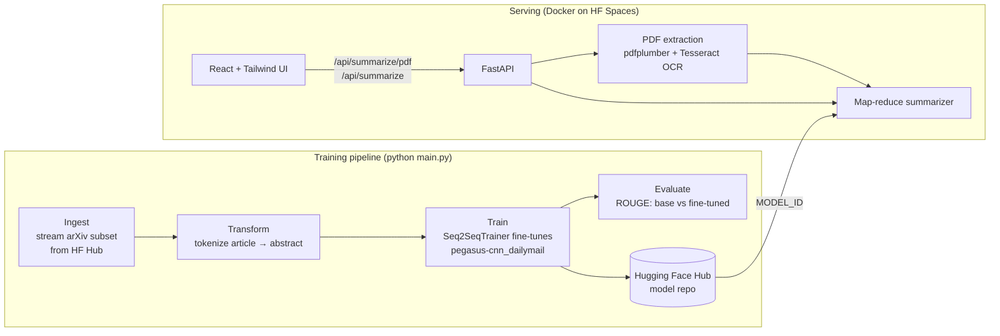

# Research Summarizer

[](https://github.com/ThisLonzoBall/Research-Summarizer/actions/workflows/ci.yml)
[](LICENSE)
[](https://huggingface.co/spaces/HF_USERNAME/research-summarizer)

Turn a research paper into an abstract-style summary. Upload a PDF (scanned pages are OCR'd) or paste text, and a
**Pegasus model fine-tuned on arXiv papers** generates the summary. Papers longer than the model's 1,024-token context are
handled with map-reduce summarization.

**[Try the live demo →](https://huggingface.co/spaces/HF_USERNAME/research-summarizer)**

<!-- Add a screenshot or GIF of the app:  -->

## Results

ROUGE F1 (×100) on 200 held-out arXiv papers:

| Model | ROUGE-1 | ROUGE-2 | ROUGE-L | ROUGE-Lsum |
|---|---|---|---|---|
| `google/pegasus-cnn_dailymail` (base) | _TBD_ | _TBD_ | _TBD_ | _TBD_ |
| Fine-tuned on arXiv (this project) | _TBD_ | _TBD_ | _TBD_ | _TBD_ |

The model was fine-tuned on 4,000 papers from [`ccdv/arxiv-summarization`](https://huggingface.co/datasets/ccdv/arxiv-summarization)
on a single Colab GPU and is published at [`HF_USERNAME/pegasus-arxiv-summarizer`](https://huggingface.co/HF_USERNAME/pegasus-arxiv-summarizer).

## Architecture



### How long papers are summarized

Pegasus reads at most 1,024 tokens, and a typical paper is 6,000+ tokens. The prediction pipeline
([`prediction_pipeline.py`](src/ResearchSummarizer/pipeline/prediction_pipeline.py)) handles this in two steps:

1. **Map:** split the text into 1,024-token windows that overlap by 100 tokens, so sentences at a boundary keep their context, and summarize the windows in batches.
2. **Reduce:** join the partial summaries and summarize them again. Repeat until the text fits in one window (at most 3 rounds).

PDF text extraction ([`pdf_loader.py`](src/ResearchSummarizer/utils/pdf_loader.py)) removes running headers and footers
(lines that repeat across pages), page numbers and end-of-line hyphenation before summarization.

## Tech stack

- **Model:** PyTorch, Hugging Face Transformers / Datasets / Evaluate, Pegasus
- **Backend:** FastAPI, pdfplumber, Tesseract OCR (pytesseract + pdf2image)
- **Frontend:** React 19, Vite, Tailwind CSS v4
- **Infra:** Docker (multi-stage), GitHub Actions CI/CD, Hugging Face Spaces, Google Colab for training
- **Quality:** pytest, ruff, ESLint

## Quickstart

### Docker

```bash
docker compose up --build
# open http://localhost:7860
```

The first start downloads the model (~2.3 GB). Set `MODEL_ID` to choose a model from the Hub:
`MODEL_ID=HF_USERNAME/pegasus-arxiv-summarizer docker compose up`.

### Local development

```bash
python -m venv .venv && source .venv/bin/activate   # Windows: .venv\Scripts\activate
pip install -r requirements-dev.txt
python app.py                                      # API on http://localhost:8080 (docs at /docs)

cd frontend && npm install && npm run dev          # UI on http://localhost:5173
```

OCR for scanned PDFs needs [Tesseract](https://github.com/tesseract-ocr/tesseract) and
[Poppler](https://poppler.freedesktop.org/) on your `PATH`. Without them, text-based PDFs still work.

### Training

On a GPU (or Colab: open [`notebooks/train_colab.ipynb`](notebooks/train_colab.ipynb) and choose *Run all*):

```bash
python main.py                         # ingest → transform → train → eval
python main.py --stage train eval      # run only some stages
```

Dataset size, sequence lengths, training arguments and generation settings are in [`params.yaml`](params.yaml). Paths are in
[`config/config.yaml`](config/config.yaml).

## API

| Method | Endpoint | Body | Description |
|---|---|---|---|
| `GET` | `/api/health` | | Model status |
| `POST` | `/api/summarize` | `{"text": "..."}` | Summarize pasted text (50–200k chars) |
| `POST` | `/api/summarize/pdf` | multipart `file` | Summarize a PDF (≤20 MB). Query options: `max_pages`, `ocr=auto\|never\|force` |

```bash
curl -F file=@paper.pdf "http://localhost:8080/api/summarize/pdf?max_pages=10"
```

```json
{"summary": "...", "model": "HF_USERNAME/pegasus-arxiv-summarizer", "input_words": 5412, "elapsed_seconds": 41.3}
```

Interactive docs are at `/docs`.

## Project structure

```
├── app.py                         # FastAPI app (API + serves built frontend)
├── main.py                        # training pipeline CLI
├── config/config.yaml             # artifact paths, dataset and model ids
├── params.yaml                    # data sizes, training and generation hyperparameters
├── src/ResearchSummarizer/
│   ├── components/                # ingestion, transformation, trainer, evaluation
│   ├── pipeline/                  # stage runners + PredictionPipeline (inference)
│   ├── config/ entity/            # typed config objects
│   └── utils/pdf_loader.py        # PDF text extraction + OCR + cleanup
├── frontend/                      # React app
├── notebooks/train_colab.ipynb    # one-click GPU training + Hub publishing
├── tests/                         # pytest suite (API, chunking, PDF parsing, config)
├── Dockerfile                     # multi-stage build: Node → Python
└── .github/workflows/             # CI + deploy to Hugging Face Spaces
```

## Limitations and future work

- **Latency:** on the free CPU Space, a full paper takes 1–3 minutes. A GPU or a distilled model (e.g. `distill-pegasus`) would cut this a lot.
- **Context:** map-reduce loses some cross-section context. Long-context models (LED, LongT5) can read 16k tokens in one pass.
- **Training budget:** the model was trained on a 4k-paper subset for one epoch. Using the full 200k-paper training split would likely improve ROUGE further.
- **Cold starts:** free Spaces go to sleep when idle, so the first request after that takes about a minute.

## License

[MIT](LICENSE) © 2025 Rahul Wadhwa
